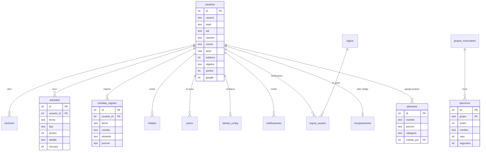

# Base de datos de FitFat

FitFat usa **una sola base de datos SQLite**: el archivo `server/datos/fitfat.db`. Así se hace en las apps reales:
no se crea una base de datos por persona. Cada persona que se registra es **una fila** en la tabla `usuarios`, y
todo lo suyo (racha, comidas, agua, sueño, peso, alertas, logros) se guarda en otras tablas con su `usuario_id`.
Así cada quien solo ve lo suyo, y si se borra una cuenta se borra todo lo suyo (`ON DELETE CASCADE`).

Para verla por dentro puedes instalar **DB Browser for SQLite** (https://sqlitebrowser.org/) y abrir el archivo
`server/datos/fitfat.db` con el servidor apagado.

## Tablas

### Datos de cada usuario

| Tabla | Qué guarda |
|---|---|
| `usuarios` | Una fila por persona: usuario, contraseña cifrada (hash scrypt + sal), nombre, fecha de nacimiento, género, estatura, peso, objetivo, correo, puntos, si entró con Google |
| `sesiones` | Tokens de sesión abiertos (un celular o navegador = una sesión) |
| `actividad` | Cada acción que suma a la racha: rutinas (grupo y minutos), comidas, hábitos; con sus puntos |
| `comidas_registro` | Alimentos registrados por día y comida (desayuno, almuerzo, cena, snack) |
| `habitos` | Por día: vasos de agua, horas de sueño, si hizo ejercicio |
| `pesos` | Historial de peso (un valor por día) |
| `alertas_config` | Canales (push, correo, SMS), tipos de alerta, hora y frecuencia |
| `notificaciones` | Bandeja de notificaciones (racha en peligro, agua, logros…) |
| `logros_usuario` | Logros que ya se le anunciaron a cada persona |
| `recuperaciones` | Código para recuperar la contraseña (cifrado, vence en 10 min) |

### Catálogos (compartidos por todos)

| Tabla | Qué guarda |
|---|---|
| `alimentos` | Los alimentos del buscador (49 al inicio). Si alguien escribe a mano un alimento que no existe, se guarda como **suyo** (`creado_por`) y le aparece en sus próximas búsquedas; los demás no lo ven |
| `grupos_musculares` | Pecho, espalda, piernas, brazos, hombros, abdomen |
| `ejercicios` | Los 4 ejercicios de cada grupo (repeticiones o segundos y la indicación) |
| `logros` | Los 12 logros (nombre, descripción y tipo). La regla para desbloquear cada uno está en `server/src/progreso.js` |

Los datos iniciales de los catálogos están en `server/src/semillas.js`: al arrancar, el servidor agrega lo que
falte. Después la base de datos manda: si agregas un alimento o cambias un ejercicio en la BD, la app lo usa.

## Diagrama

